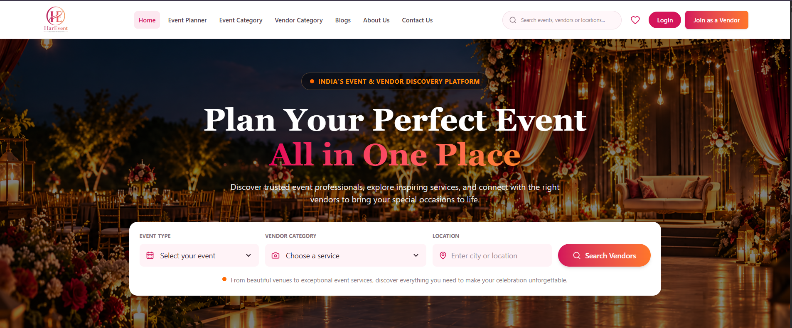

# HarEvent

HarEvent is an event and vendor discovery web app built with React and Vite. The home page introduces the service and helps visitors start searching for event professionals.

## Preview



## Features

- Home page with event, vendor category, and location search fields
- Responsive navigation with links to the available sections
- Footer with company, vendor, and contact links
- Fixed WhatsApp-style button that opens the NiDi HarEvent chatbot
- Route scaffolds for the main visitor and vendor pages

## Tech stack

- React
- Vite
- React Router
- Tailwind CSS
- Lucide React and React Icons

## Getting started

Install dependencies:

```bash
npm install
```

Start the development server:

```bash
npm run dev
```

Vite prints the local URL in the terminal. To use port `5173` explicitly:

```bash
npm run dev -- --port 5173
```

The NiDi chatbot also needs its API running. In a second terminal, start the
backend from the sibling chatbot project:

```bash
cd ../HarEvent-chatbot/backend
npm install
node server.js
```

The backend listens on `http://localhost:5000`. For deployment, set
`VITE_CHATBOT_API_URL` to the deployed chatbot API URL before building the
frontend (for example, `https://api.example.com/api/chat`).

## Available scripts

| Command | Description |
| --- | --- |
| `npm run dev` | Start the development server |
| `npm run build` | Create a production build in `dist/` |
| `npm run preview` | Preview the production build locally |
| `npm run lint` | Run ESLint |

## App routes

| Path | Page |
| --- | --- |
| `/` | Home |
| `/event-planners` | Event Planners |
| `/event-categories` | Event Categories |
| `/vendor-categories` | Vendor Categories |
| `/blogs` | Blogs |
| `/about` | About |
| `/contact` | Contact |
| `/login` | Login |
| `/favorites` | Favorites |
| `/join-as-vendor` | Join as a Vendor |
| `/search` | Search |

The non-home routes are currently page scaffolds and can be filled in as the app develops.
